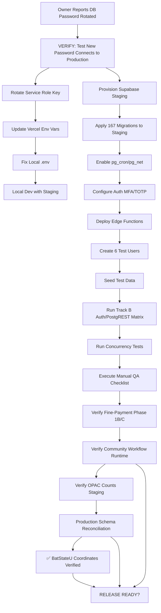

# SHELF ILMS Remaining Blockers & Owner Actions

**Version:** 1.0
**Date:** 2026-11-17
**Status:** All implementation complete — External dependencies block release readiness

---

## Blocker Classification

| Severity | Definition |
|----------|------------|
| **CRITICAL** | Must be resolved before ANY deployment consideration; security/production impact |
| **HIGH** | Blocks release readiness verification; requires owner provisioning/action |
| **MEDIUM** | Affects completeness/accuracy; should be resolved before production |
| **LOW** | Nice-to-have; documentation or minor verification gaps |

---

## CRITICAL Blockers (Owner Action Required)

### 1. Database Password Rotation — **OWNER REPORTED COMPLETE — VERIFICATION PENDING**
- **Issue:** `SUPABASE_DB_PASSWORD` (`[REDACTED]`) committed in git commit `5231b33` (2026-10-24) and present in working directory `.env`
- **Risk:** Full database access compromise — **old password must remain treated as compromised until new password independently verified**
- **Owner Reported Action:** Reset via Supabase Dashboard → Settings → Database → "Reset database password"
- **Required Verification (NOT YET PERFORMED):**
  - [ ] Owner tests new password connects to production database using procedure in `RELEASE_VALIDATION_RUNBOOK.md` → **Part 0: Production Database Password Verification** (secure `psql` interactive prompt, `SELECT 1`, SSL, failure diagnosis)
  - [ ] Owner confirms all environments updated (Vercel, local, CI/CD) with new password
- **Timeline:** Verification required BEFORE any deployment consideration

### 2. Service Role Key Rotation — **IMMEDIATE (if applicable)**
- **Issue:** Service role key (bypasses RLS, admin API) may exist in local files
- **Risk:** Full administrative access compromise
- **Source Inventory:** See `RELEASE_VALIDATION_RUNBOOK.md` → **Service Role Key Inventory (Source-Only)** — all 7 Edge Functions use `Deno.env.get("SUPABASE_SERVICE_ROLE_KEY")`; no hardcoded values in repo; no tracked files contain literal key values
- **Owner Action:**
  - [ ] Check Supabase Dashboard → Settings → API → "Reveal service_role key"
  - [ ] If key was ever stored locally (`.env`, config files, notes), click "Regenerate"
  - [ ] Update Edge Function secrets in Supabase Dashboard with new key (all 7 functions)
  - [ ] Update any local development config
  - [ ] Audit external stores: Vercel env vars, CI/CD secrets, password managers (see Runbook table)
- **Note:** Not found in git history, but local/external storage possible

### 3. Vercel Environment Variables Update — **HIGH**
- **Issue:** Vercel may have privileged secrets (DB password, service role) in environment variables
- **Risk:** Credential leakage through Vercel deployment
- **Owner Action:**
  - [ ] Go to Vercel Dashboard → Project → Settings → Environment Variables
  - [ ] Remove any `SUPABASE_DB_PASSWORD` or service role keys
  - [ ] Update `VITE_SUPABASE_URL` and `VITE_SUPABASE_ANON_KEY` after Supabase rotation (if project changed)
  - [ ] Ensure only public credentials (`VITE_SUPABASE_URL`, `VITE_SUPABASE_ANON_KEY`, analytics keys) remain
- **Verification:** Redeploy preview to confirm no privileged secrets in build

### 4. Local Environment Fix — **HIGH**
- **Issue:** `.env`, `.env.local`, `env` files in working directory point to PRODUCTION Supabase
- **Risk:** Accidental production writes during development
- **Owner Action:**
  - [ ] Delete `.env`, `.env.local`, `env` from working directory
  - [ ] Provision local Supabase project (`supabase start` on Linux/macOS) OR use staging project
  - [ ] Create new `.env` with LOCAL/STAGING credentials only
  - [ ] Verify `supabase/config.toml` project_id matches local/staging project
- **Constraint:** Never commit `.env` files (in `.gitignore`)

---

## HIGH Blockers (Infrastructure Provisioning Required)

### 5. Isolated Supabase Staging Project — **HIGH**
- **Issue:** No Track B infrastructure for Auth/PostgREST/Edge Function verification
- **Requirement:** Full Supabase stack with Auth (MFA/TOTP), PostgREST, Storage, Vault, Edge Functions, Realtime, pg_cron, pg_net
- **Options:**
  - **Option A (Free):** Local `supabase start` on Linux/macOS (Windows not supported)
  - **Option B (Paid):** Dedicated Supabase staging project at supabase.com
- **Owner Action:**
  - [ ] Choose option and provision
  - [ ] Apply all 167 migrations
  - [ ] Enable `pg_cron` and `pg_net` extensions (Database → Extensions)
  - [ ] Configure Auth: Email provider, MFA/TOTP enabled
  - [ ] Deploy Edge Functions (`supabase functions deploy`)
  - [ ] Configure Storage buckets
  - [ ] Set up Mailpit or similar for email capture
- **Dependencies:** Required for Track B, Manual QA, Fine-payment Phase 1B/C

### 6. Track A: Clean Migration Replay — **HIGH**
- **Issue:** No independent PostgreSQL replay executed
- **Requirement:** Isolated PostgreSQL 15+ (not shared Docker)
- **Owner Action:**
  - [ ] Provision isolated PostgreSQL (local install or dedicated Docker container)
  - [ ] Execute steps in `DATABASE_REPLAY_PROCEDURE.md` Part 1-7
  - [ ] Document: 4 migrations fail on `pg_cron`/`pg_net` (expected on Windows)
  - [ ] All 12 SQL assertions must pass
- **Known Gap:** `20270103000800`, `20270103000900`, `20270103001100`, `20261122000000` fail on Windows PostgreSQL 18

### 7. Track B: Auth/PostgREST Matrix Execution — **HIGH**
- **Issue:** No real Auth/MFA/PostgREST verification
- **Requirement:** 6 test users, real Auth-issued tokens, full matrix
- **Owner Action:**
  - [ ] After #5 complete, create 6 test users per `AUTH_POSTGREST_TEST_PLAN.md`
  - [ ] Seed test data (2 libraries, books, requests, fines, attendance, community requests)
  - [ ] Execute `npm run test:auth-postgrest` with fixture
  - [ ] Execute 8 concurrency scenarios from `concurrency_test_scenarios.sql`
  - [ ] Complete P0/P1 tests from `SHELF_FINAL_MANUAL_QA_CHECKLIST.md`
- **Dependencies:** Requires #5 complete

### 8. Production Schema Reconciliation — **HIGH**
- **Issue:** Production Supabase schema not verified against local migrations
- **Requirement:** Read-only catalog export from production
- **Owner Action:**
  - [ ] Owner creates read-only libpq service entry `shelf-readonly-production`
  - [ ] Owner verifies connection target independently
  - [ ] Execute `scripts/export-production-catalog-readonly.sql` against production
  - [ ] Save output to secure location (outside repo)
  - [ ] Run `scripts/reconcile-migration-evidence.mjs` with history, catalog, and reviewed effects manifest
  - [ ] Document any drift between local migrations and production catalog
- **Constraint:** Owner must perform — requires production access

---

## MEDIUM Blockers (Verification Completeness)

### 9. Fine-Payment Privacy Phase 1B/C — **MEDIUM**
- **Issue:** Phase 1A (internal hardening, cohort suppression) complete; Phases 1B/C pending
- **Phase 1B:** Verify all fine-payment RPC overloads, Edge Function auth paths
- **Phase 1C:** Verify frontend fallback paths, views, exports, Edge Functions for leakage
- **Owner Action:**
  - [ ] During Track B, test all fine-payment RPC variants with different roles
  - [ ] Verify `send-fine-reminder` Edge Function requires AAL2 + JWT role match
  - [ ] Check Super Admin dashboard exports for PII leakage
  - [ ] Verify Sub-admin dashboard exports are branch-scoped
  - [ ] Document any gaps for forward-only migration fixes

### 10. BatStateU JPLPC Malvar Coordinates Verification — **MEDIUM** ✅ **COMPLETED**
- **Issue:** Migration `20270103000500` adds `coordinates_verified` flag but coordinates lacked authoritative source
- **Resolution:** Coordinates verified and corrected using authoritative sources (Wikipedia, OpenStreetMap, PhilAtlas)
- **Corrected Coordinates:** BatStateU JPLPC Malvar Campus: **14.04482, 121.15677** (G. Leviste St., Poblacion, Malvar, Batangas)
- **Previous Incorrect:** 14.0672, 121.1597 (Darasa, Tanauan - ~2.5km away)
- **Applied In:** `supabase/schema.sql` seed data updated; migration documentation updated
- **Owner Action (Remaining):**
  - [ ] Set `coordinates_verified = true` in production after confirming seed data matches
  - [ ] Verify LibraryMap component displays correct location in staging

### 11. OPAC Count Consistency Verification — **MEDIUM**
- **Issue:** Source fix complete (SECURITY INVOKER RPCs, pagination); production deployment not verified
- **Owner Action:**
  - [ ] After Track B staging verified, deploy to Vercel preview with staging Supabase
  - [ ] Execute `SHELF_STAGING_TEST_INSTRUCTIONS.md` Part 5 (OPAC verification)
  - [ ] Confirm localhost ↔ Vercel counts match (same data source)
  - [ ] Verify external catalog pagination (>1000 books)
  - [ ] Verify debug panel shows RPC/client consistency

### 12. Community Workflow Runtime Verification — **MEDIUM**
- **Issue:** Source complete (promotion sync fix `20270117000000`, cancellation, expiry); runtime not tested
- **Owner Action:**
  - [ ] During Track B, test complete community workflow:
    - Request → Approve → Pickup → Return → Queue promotion
    - Cancellation at all states (pending, approved, borrowed)
    - 7-day auto-expiry via `auto_expire_community_requests()` cron
    - Concurrent promotions (concurrency scenario 6, 7)
  - [ ] Verify synchronous promotion works under load
  - [ ] Verify `pg_notify` dead code removal confirmed (no listeners needed)

---

## LOW Blockers (Documentation/Process)

### 13. Git History Secret Purging — **LOW**
- **Issue:** 3 commits + working directory contain production credentials
- **Owner Action:**
  - [ ] After rotation complete, consider `git filter-repo` or BFG Repo-Cleaner to purge secrets from history
  - [ ] Requires force-push coordination with all collaborators
  - [ ] **Do not rewrite history without separate authorization**

### 14. Dependency Audit (npm audit) — **LOW**
- **Issue:** 9 moderate advisories (including ExcelJS downgrade suggestion)
- **Owner Action:**
  - [ ] Review `npm audit --omit=dev` output
  - [ ] Assess ExcelJS 3.4.0 downgrade compatibility
  - [ ] Apply fixes only after compatibility review

### 15. Deployed Edge Function Drift — **LOW**
- **Issue:** `smart-responder` Edge Function deployed in production but absent from local source
- **Owner Action:**
  - [ ] Review deployed function code in Supabase Dashboard
  - [ ] Decide: add to local source, or confirm intentional removal
  - [ ] Document decision

---

## Owner Action Checklist Summary

| # | Action | Severity | Owner | Dependencies | Done |
|---|--------|----------|-------|--------------|------|
| 1 | **Verify** database password rotation (owner reported complete) | CRITICAL | Owner | — | [ ] |
| 2 | Rotate service role key (if stored locally) | CRITICAL | Owner | — | [ ] |
| 3 | Update Vercel env vars (remove privileged) | HIGH | Owner | #1, #2 | [ ] |
| 4 | Fix local `.env` (point to local/staging) | HIGH | Owner | #5 | [ ] |
| 5 | Provision isolated Supabase staging | HIGH | Owner | — | [ ] |
| 6 | Execute Track A migration replay | HIGH | Owner/DBA | #5 (for pg_cron/pg_net) | [ ] |
| 7 | Execute Track B Auth/PostgREST matrix | HIGH | Owner/QA | #5, #6 | [ ] |
| 8 | Production schema reconciliation | HIGH | Owner | Production access | [ ] |
| 9 | Fine-payment privacy Phase 1B/C | MEDIUM | Dev/QA | #7 | [ ] |
| 10 | BatStateU coordinates verified | MEDIUM | Owner | Authoritative source | [x] |
| 11 | OPAC count consistency (staging) | MEDIUM | QA | #7 | [ ] |
| 12 | Community workflow runtime | MEDIUM | QA | #7 | [ ] |
| 13 | Git history secret purge (optional) | LOW | Owner | #1, #2 complete | [ ] |
| 14 | Dependency audit review | LOW | Dev | — | [ ] |
| 15 | Deployed Edge Function drift | LOW | Dev/Owner | Supabase Dashboard access | [ ] |

---

## Readiness Gate Dependencies

**Release Ready ONLY when ALL paths to U are complete with documented evidence — INCLUDING independent verification of database password rotation.**

---

## Communication Template for Owner

When requesting owner actions, use this format:

> **Subject:** SHELF ILMS — Owner Action Required: [Action Name]
>
> **Severity:** CRITICAL/HIGH/MEDIUM/LOW
>
> **Description:** [One paragraph]
>
> **Required Steps:**
> 1. [Step 1]
> 2. [Step 2]
>
> **Dependencies:** [What must be done first]
>
> **Verification:** [How to confirm complete]
>
> **Deadline:** [Date or "Before Track B provisioning"]
>
> **Reference Doc:** [Link to relevant section in this file or `RELEASE_VALIDATION_RUNBOOK.md`]

---

## Escalation Path

If owner cannot complete CRITICAL actions:
1. Document risk acceptance in writing
2. Do NOT proceed to production deployment
3. Capstone demonstration proceeds with local/staging only
4. Release readiness remains **NOT READY** in all deliverables

---

## Final Statement

**All implementation work is complete.** The 18-area audit is done. 167 migrations are validated. Automated checks pass. The remaining blockers are **external dependencies** requiring owner provisioning, credential rotation verification, and infrastructure access. No further code changes are needed unless Track A/B execution reveals defects.

**Database password rotation: OWNER REPORTED COMPLETE — NOT INDEPENDENTLY VERIFIED.** Old password (`[REDACTED]`) must remain treated as compromised until the owner demonstrates the new password successfully connects to the production database.

**Next milestone:** Owner independently verifies database password rotation, completes remaining CRITICAL actions (#2-4), and provisions Track B infrastructure (#5). Then Track A/B execution and Manual QA can proceed in parallel.

---

**Document Control:** This blocker list is derived from `MASTER_AUDIT_AND_IMPLEMENTATION_PLAN.md`, `RELEASE_VALIDATION_RUNBOOK.md`, `DATABASE_REPLAY_PROCEDURE.md`, `AUTH_POSTGREST_TEST_PLAN.md`, and `REMEDIATION_PROGRESS.md` as of 2026-11-17.